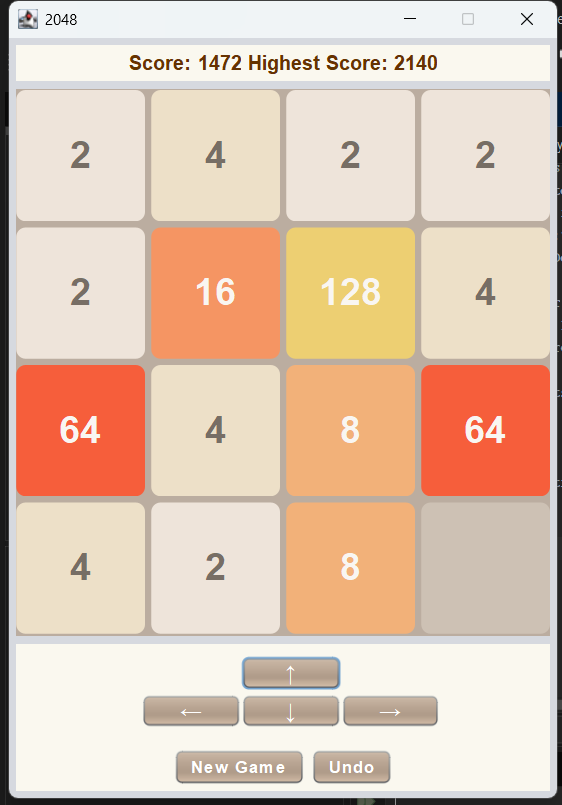

# 2048

## Project Overview

2048 is a Java Swing implementation of the classic 2048 puzzle game, developed
as a Challenge-Based Learning (CBL) project for the 2IP90 course at Eindhoven
University of Technology.

The objective is to combine tiles of equal value to reach 2048. Our
implementation includes a graphical user interface, keyboard and on-screen
controls, score tracking, persistent high scores, and a stack-based Undo feature
that allows players to reverse previous moves.

## Requirements

- **Java Development Kit (JDK) 26** — required to compile and run the project.
- **Apache Maven** — required for building and running the project using the
command-line instructions.
- **Apache NetBeans IDE 31 (optional)** — recommended for opening, building,
and running the project through an IDE. NetBeans includes Apache Maven.

The application uses standard Java libraries, including Swing, and does not
require additional third-party libraries.

## Installation and Setup

The 2048 application is developed using Java Swing and Maven and is
intended to run on Windows, macOS, and Linux.

The recommended method is to use Apache NetBeans IDE.

### Option A: Using Apache NetBeans (Recommended)

#### Step 1: Install Java Development Kit (JDK) 26

1. Visit the [Oracle Java Downloads](https://www.oracle.com/java/technologies/downloads/) website.
2. Locate **JDK 26**.
3. Download the appropriate installer or package for your operating
   system (Windows, macOS, or Linux).
4. Follow the installation instructions for your operating system.
5. Open Command Prompt (Windows) or Terminal (macOS/Linux).
6. Verify the Java installation by entering:

   ```bash
   java --version
   javac --version
   ```

7. Both commands should display Java version 26.

#### Step 2: Install Apache NetBeans IDE

1. Visit the [Apache NetBeans website](https://netbeans.apache.org/).
2. Download **Apache NetBeans IDE 31**.
3. Install or extract NetBeans following the instructions for your
   operating system.
4. Launch Apache NetBeans.
5. Ensure that NetBeans is configured to use JDK 26.

**Note:** Apache NetBeans includes Maven, so a separate Maven
installation is not required when using this method.

#### Step 3: Open the 2048 Project

1. Download the submitted `2048.zip` file.
2. Extract the ZIP file to a folder on your computer.
3. Launch Apache NetBeans.
4. Select **File > Open Project**.
5. Navigate to the extracted project folder containing `pom.xml`.
6. Select the project folder and click **Open Project**.

#### Step 4: Build and Run the Application

1. Locate the `2048` project in the NetBeans Projects window.
2. Right-click the project and select **Clean and Build**.
3. Wait until the Output window displays `BUILD SUCCESS`.
4. Right-click the project again and select **Run**.
5. The 2048 game window should open and be ready to play.

### Option B: Using Apache Maven (Without NetBeans)

#### Step 1: Install JDK 26

Install JDK 26 using the instructions provided in Option A.

#### Step 2: Install Apache Maven

1. Visit the [Apache Maven download page](https://maven.apache.org/download.cgi).
2. Download Apache Maven for your operating system.
3. Follow the [official Maven installation instructions](https://maven.apache.org/install.html).
4. Configure the `JAVA_HOME` environment variable to point to JDK 26.
5. Ensure that Maven's `bin` directory is included in your system's
   `PATH` environment variable.
6. Open Command Prompt or Terminal and verify the installation:

   ```bash
   mvn --version
   ```

**Important:** Ensure that Maven uses JDK 26 before building the project.
Run `mvn --version` and check that the displayed Java version is 26.
If another version is displayed, configure `JAVA_HOME` to point to
your JDK 26 installation and update your system's `PATH` accordingly.


#### Step 3: Build the Project

1. Extract the submitted `2048.zip` file.
2. Open Command Prompt or Terminal.
3. Navigate to the extracted project folder containing `pom.xml`.
4. Execute the following command:

   ```bash
   mvn clean package
   ```

5. Wait until Maven displays `BUILD SUCCESS`.

#### Step 4: Run the Application

From the same project directory, execute:

```bash
mvn exec:java -Dexec.mainClass=com.mycompany.App
```

The 2048 game window should open.

### Platform Compatibility

The application uses Java Swing and standard Java libraries and is
designed to support Windows, macOS, and Linux.

### Additional Notes

- No third-party Java libraries are required.
- The application does not require an internet connection during gameplay.

## How to Play

1. Start the game using either of the methods described above.
2. Use the **arrow keys** or the **on-screen directional buttons** to move all
tiles up, down, left, or right.
3. When two tiles of the same value collide during a move, they merge into one
tile with double the value.
4. Each successful merge increases the player's score by the value of the
resulting tile.
5. After a valid move, a new tile appears on an empty cell.
6. Continue combining tiles to create a **2048 tile** and win the game.
7. The game ends when the board is full and no valid moves remain.

### Additional Controls

- **New Game** — starts a new game and resets the current score.
- **Undo** — reverses the previous valid move, restoring the board and score.
- **Highest Score** — displays the highest score saved across game sessions.

## Game Features

- **Graphical User Interface:** A Java Swing interface featuring a 4×4 game board
with custom-designed tiles and controls.
- **Tile Movement and Merging:** Tiles move in four directions and merge when
they have matching values.
- **Score Tracking:** The current score updates whenever tiles merge.
- **Persistent High Score:** The highest score is saved and retained between
game sessions.
- **Undo System:** A stack-based system that allows players to reverse previous
valid moves, restoring the board and score.
- **New Game:** Players can restart the game at any time.
- **Victory Detection:** The game displays a victory message when a 2048 tile is
created.
- **Game Over Detection:** The game identifies when no valid moves remain.
- **Multiple Input Methods:** Players can either use keyboard arrow keys or
on-screen directional buttons.

## Screenshots



## Project Structure

The project follows the standard Maven directory structure. All Java source files
are located in `src/main/java/com/mycompany/`.

### Java Classes

- **App.java** — the application's entry point, which launches the game.
- **Game2048.java** — manages the game board, tile movement, merging, scoring,
and win/loss conditions.
- **GameDisplay.java** — implements the Java Swing interface, processes player
input, and updates the displayed game state.
- **GameHistory.java** — manages the stack-based Undo system, storing previous
board states and scores.
- **TileGenerator.java** — generates new tiles in available board positions.
- **RoundedTile.java** — provides the custom appearance of an individual tile.
- **RoundedPanel.java** — provides custom rounded panel components.
- **CloudyPanel.java** — provides a custom panel used in the graphical interface.

### Other Project Files

- **pom.xml** — contains the Maven project configuration and build settings.
- **2IP90_checks.xml** — contains the course-specific Checkstyle rules.
- **README.md** — provides project documentation and instructions.
- **screenshots/** — contains the gameplay screenshot used in this README.

## Authors

Developed by:

- Zara Tasnim (Student number: 2450607)
- Selena Sirbu (Student number: 2472007)

Eindhoven University of Technology (TU/e)

Course: 2IP90 — Challenge-Based Learning (CBL) Project

Academic Year: 2026-2027